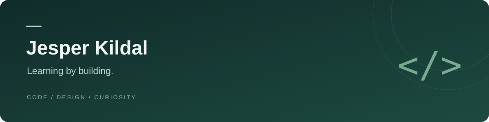

### Hi, I'm Jesper 👋

I like turning ideas into useful things, learning along the way, and paying attention to the details that make something feel good to use.

#### What interests me

- **Code** — understanding how things work by building and experimenting.
- **Design** — clear interfaces, thoughtful details, and simple experiences.
- **Progress** — small improvements that add up over time.

#### A little personality

Curiosity tends to lead to another project. Golf is a good reason to step away from the screen. ⛳

---

Always learning. Always a work in progress.
